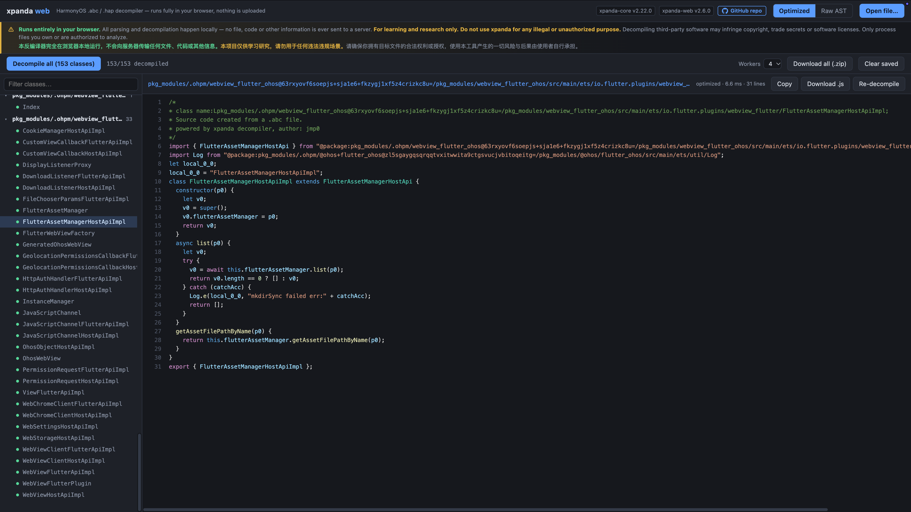

# xpanda

**English** | [简体中文](README.zh.md)

**Web decompiler:** <https://tencent.jmp0.top/xpanda>

> "Holy crap — when he read it, he froze and said: with a **HarmonyOS decompiler** this good, why on earth didn't you tell me sooner?"

A decompiler for HarmonyOS `.abc` files (Panda / ArkCompiler bytecode), written in **pure TypeScript**. Node.js ≥ 18, zero native dependencies.

It turns `.abc` files back into readable JavaScript: classes, methods, functions, control flow and module `import`/`export` are restored, and an optimizer pipeline cleans up the register temporaries emitted by the compiler.

Supported bytecode versions: `24.0.0.0` (backward compatible with `13.0.1.0`; ArkTS 12 packages, `12.0.2.0`, decompile as well).



## Features

- **Pure TypeScript, zero native dependencies**: parses `.abc` files and emits readable JavaScript that can run as-is;
- **Classes and functions**: class fields, accessors, prototype methods, closures and lexical environments (`local` / `sendable` env);
- **Control flow**: `if/else`, `while/do-while`, `for`, `try/catch`, and more; falls back to labeled linear output when structural analysis fails;
- **Modules**: ES Module `import` / `export`;
- **Babel AST optimizer**: register-temp copy propagation, dead-store elimination, function/class syntax recovery, call rewriting and compound-assignment folding;
- **MCP Server**: lets AI clients such as Claude Code, OpenCode and Cursor analyze `.abc` files on demand;
- **Web UI**: drag & drop a `.abc` / `.hap` file in the browser and decompile it entirely client-side — nothing is uploaded.

## Requirements

- Node.js ≥ 18

## Monorepo layout

The project is split into four npm-workspace packages under `packages/`:

| Package | Purpose |
|---|---|
| `xpanda-core` | `.abc` / `.hap` parsing, disassembly, decompilation and the optimizer — the library everything else builds on |
| `xpanda-cli` | command line interface (`decompile` / `unpack-index`) |
| `xpanda-mcp` | MCP server (stdio) for AI client integration |
| `xpanda-web` | browser UI (React + Vite, pure frontend) |

## Install and use

```bash
npm install
```

CLI (run from the repository root):

```bash
npx tsx packages/xpanda-cli/src/cli.ts decompile <file.abc|file.hap> [-o outDir] [--no-simplify] [--stdout] [--quiet] [-j N]
```

| Option | Description |
|---|---|
| `-o outDir` | Output directory, defaults to `out` |
| `--no-simplify` | Skip the optimizer and emit raw decompiler output; faster |
| `--stdout` | Print the result to stdout instead of writing files |
| `--quiet` | Suppress progress logs |
| `-j, --jobs N` | Number of workers that run simplify per class; `0` = auto (CPU-1, max 4) |

HAP support:

- Given a `.hap` input (HarmonyOS ability package, a ZIP container), every `.abc` entry
  inside is extracted and decompiled; class files go to `outDir/<abc entry path>/`
  (e.g. `ets/modules.abc` → `out/ets/modules/`), and `resources.index` is unpacked
  to `outDir/resources.json`;
- The `unpack-index` subcommand can also unpack a standalone `resources.index`.

Examples:

```bash
# Full decompilation (with optimizer)
npx tsx packages/xpanda-cli/src/cli.ts decompile app.abc -o out --quiet

# Per-class parallelism for large files (worker_threads)
npx tsx packages/xpanda-cli/src/cli.ts decompile app.abc -o out -j 4 --quiet

# Inspect raw output without optimization
npx tsx packages/xpanda-cli/src/cli.ts decompile app.abc -o out --no-simplify --quiet

# Print to the terminal
npx tsx packages/xpanda-cli/src/cli.ts decompile app.abc --stdout --quiet
```

For large files, raise the heap limit and enable per-class parallelism:

```bash
NODE_OPTIONS=--max-old-space-size=4096 \
  npx tsx packages/xpanda-cli/src/cli.ts decompile app.abc -o out -j 4 --quiet
```

## Programmatic API

```ts
import * as fs from "fs";
import { PandaFile, PandaDecompiler } from "xpanda-core";

const pandaFile = new PandaFile(new Uint8Array(fs.readFileSync("app.abc")));
const decompiler = new PandaDecompiler();

for (const cls of pandaFile.getAllClasses()) {
    const js = decompiler.decompileClass(cls);       // with simplify
    // const js = decompiler.decompileClassRaw(cls); // without simplify
}
```

## MCP Server

xpanda ships a built-in [Model Context Protocol](https://modelcontextprotocol.io) server, so AI clients such as Claude Code, OpenCode and Cursor can drive the decompiler — letting an agent analyze `.abc` and `.hap` files (HarmonyOS app packages containing bytecode and resources) on demand: load → browse classes → inspect metadata → decompile a single class → cross-check disassembly → search strings → query resources.

```bash
npm run mcp          # start it (stdio transport)
npm run test:mcp     # end-to-end test
```

| Tool | Purpose |
|---|---|
| `abc_load` | Parse an `.abc` or `.hap` file and return a `fileId`; for haps, a package summary plus the list of `.abc` entries |
| `hap_read_abc` | Extract an `.abc` entry from a hap into an abc session; the returned `abcFileId` works with every `abc_*` tool |
| `hap_resources` | Parse the hap's `resources.index` and query resources by name / type / limit key / id |
| `abc_list_classes` | Page through classes (name / method count / field count) with substring filtering |
| `abc_get_class` | Class metadata: superclass, fields, methods (shorty prototypes), import/export |
| `abc_decompile_class` | Decompile a single class to JavaScript, with a degradation flag |
| `abc_disassemble_method` | Method-level disassembly (basic blocks + jump targets + try-catch membership) |
| `abc_search_strings` | Search the string pool (substring or regex) to locate URLs, keys and other leads |
| `abc_export` | Decompile everything to disk (equivalent to the CLI decompile) |
| `abc_close` | Release the session's memory (abc or hap) |

Client integration:

```bash
# Claude Code
claude mcp add xpanda -- npx tsx /absolute/path/to/xpanda/packages/xpanda-mcp/src/server.ts

# OpenCode
opencode mcp add xpanda -- npx tsx /absolute/path/to/xpanda/packages/xpanda-mcp/src/server.ts
```

Generic JSON config (Claude Desktop / Cursor, etc.):

```json
{
  "mcpServers": {
    "xpanda": {
      "command": "npx",
      "args": ["tsx", "/absolute/path/to/xpanda/packages/xpanda-mcp/src/server.ts"]
    }
  }
}
```

See [docs/MCP.md](docs/MCP.md) for the full tool reference.

## Web UI

xpanda also ships a browser UI that decompiles `.abc` files and `.hap` app packages **entirely in the browser** — nothing is ever uploaded.

```bash
npm run web          # vite dev server → http://localhost:5173
```

- Drag & drop anywhere or pick files (`.abc` / `.hap`, multiple supported); haps are unpacked in-memory and every `.abc` entry gets its own class list;
- Class list with search and package grouping; click a class to decompile it, or run "decompile all" with a live progress bar (cancellable);
- Copy / download single classes, or pack every result into a `.zip`; output mode toggle **Optimized** / **Raw AST**;
- Zero-dependency syntax highlighting with line numbers.

See [packages/xpanda-web/README.md](packages/xpanda-web/README.md) for details.

## References

Bytecode format, instruction semantics, and the `resources.index` layout follow the official OpenHarmony repositories:

- [arkcompiler_runtime_core](https://gitcode.com/openharmony/arkcompiler_runtime_core) — ISA definitions (`isa/isa.yaml`), bytecode file format, and verifier;
- [arkcompiler_ets_runtime](https://gitcode.com/openharmony/arkcompiler_ets_runtime) — the dynamic-language interpreter implementation (execution semantics of each instruction, e.g. the `callthis*withname` family);
- [developtools_global_resource_tool](https://gitcode.com/openharmony/developtools_global_resource_tool) — the `restool` implementation (`ResourceTable::LoadResTable`), used to parse `resources.index`.

## License

See [LICENSE](LICENSE).
